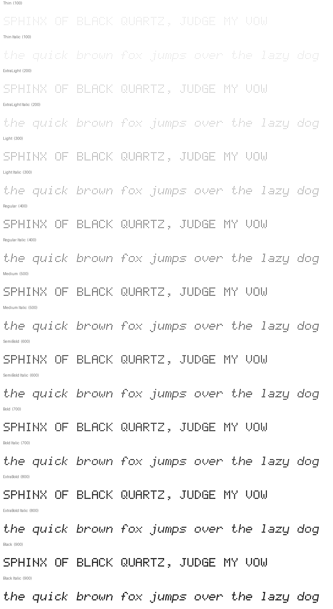

# DOT//ZERO (DotZero)

DOT//ZERO: an original 5×7 dot-matrix display family. Every glyph is made of separate round dots, in 9 weights plus slanted italics.



> **Status:** 1.000, prepared locally. It is not yet published to GitHub, and it has no release or Pages site yet.

## Styles and formats
9 weights × 2 slopes = **18 static styles**, each as **TTF** (TrueType outlines), **OTF** (CFF outlines), and **WOFF2**, for 54 files. There are also **2 variable fonts** (`wght` 100–900: `DotZero[wght]` and `DotZero-Italic[wght]`, TTF + WOFF2).

| Weight | 100 | 200 | 300 | 400 | 500 | 600 | 700 | 800 | 900 |
|---|---|---|---|---|---|---|---|---|---|
| Name | Thin | ExtraLight | Light | Regular | Medium | SemiBold | Bold | ExtraBold | Black |

Each has an Italic. Naming follows the RIBBI model: Regular, Italic, Bold, and Bold Italic share family `DotZero`. Other weights use family `DotZero <Weight>` (name ID 1/2) plus typographic names `DotZero` / `<Style>` (ID 16/17).

**Variable fonts:** Built from all 9 masters per slope. Dot diameter and squareness interpolate continuously, so `wght` is a smooth LED-brightness control.

## Design
DotZero is a **fixed-pitch dot-matrix**: a 5×7 matrix (x-height 5, 2-row descenders, accents above) on a 110-unit pitch, in a 6-dot (660-unit) monospaced cell.

* Each lit cell is **one closed dot**. Dots are never unioned, so no weight can close a counter: a one-dot gap is always ≥ 4 units of paper, even at Black.
* **Weight changes the dot**: 28-unit pin-pricks at Thin, 72 at Regular, 106 at Black. From Medium up the dot also becomes slightly squarer (superellipse handle 0.5523 → 0.76), like a high-brightness LED segment. Ink grows without the dots touching.
* **Italics** slant the matrix 10° but keep every dot round, as on a physically tilted display.
* The **dotted zero** is the brand mark and the default. `zero` gives a slashed zero and `ss01` a plain one.
* Terminal glyphs keep the pitch: box-drawing rules are dotted on the same 110-unit grid (edge dots are shared, so lines continue across cells). Blocks are solid so TUIs tile, and shades are dot fields.

## Where it shines
DOT//ZERO is a **monospaced display matrix**. Every character is exactly 6 dot-pitches wide, so numbers and status text never jitter when values change. That's what departure boards, meters and clocks need.

| Use | Suggested styles |
|---|---|
| Glowing LED boards (dark bg) | Light–Regular, plus a CSS `text-shadow` glow |
| Printed / light backgrounds | Medium–Black (dots read as ink) |
| Terminal accents, TUIs | Regular, SemiBold (dotted box drawing on the same pitch) |

Brand note: the family name is **DotZero** in font menus (name IDs 1/16). **DOT//ZERO** is the display wordmark only, so `//` never appears in any font name.

## OpenType features
`zero` (slashed zero), `ss01` (plain zero).

## Coverage
375 glyphs, 372 encoded code points (full manifest: [docs/COVERAGE.md](docs/COVERAGE.md), [docs/coverage.json](docs/coverage.json)).

| Block | Code points |
|---|---|
| Basic Latin | 95 |
| Latin-1 Supplement | 93 |
| Latin Extended-A | 2 |
| General Punctuation | 10 |
| Currency Symbols | 1 |
| Arrows | 4 |
| Box Drawing | 128 |
| Block Elements | 32 |
| Private Use (Powerline) | 7 |

Not yet covered: ¼ ½ ¾ (U+00BC–00BE), Latin Extended-A beyond ı/Ÿ, Greek, Cyrillic, and Nerd Font icons.

## Install

### Linux (per user)
```sh
mkdir -p ~/.local/share/fonts/DotZero
cp fonts/otf/*.otf fonts/variable/*.ttf ~/.local/share/fonts/DotZero/   # or unzip the release archive
fc-cache -f ~/.local/share/fonts
fc-list | grep -i dotzero
```
Install either the static OTFs **or** the TTFs, not both, to avoid duplicate menu entries. The variable TTFs can sit alongside the static fonts.

### Nix / NixOS
```nix
# flake input:  dotzero.url = "github:r3dg0d/dotzero-font";
fonts.packages = [ inputs.dotzero.packages.${pkgs.system}.default ];
```
Or `nix build .#dotzero` in this repo (it builds from source and runs the test suite).

### Arch Linux
`packaging/PKGBUILD` installs a release archive. Fill in the checksum once a release exists.

### Web
```html
<link rel="stylesheet" href="css/dotzero.css">            <!-- static, Latin + terminal subsets -->
<link rel="stylesheet" href="css/dotzero-variable.css">   <!-- family "DotZero Variable" -->
```
```css
body { font-family: "DotZero", monospace; font-feature-settings: "zero" 0; }
```
Terminal and editor snippets: [docs/terminals.md](docs/terminals.md).

## Build from source
```sh
nix develop          # or nix-shell
make fonts           # deterministic: sources/ufo → fonts/{ttf,otf,woff2,variable} + SHA256SUMS
make test            # pytest suite
python3 tools/webfonts.py && python3 tools/qa.py all   # subsets, CSS, specimens, coverage, regression
make fontbakery      # FontBakery universal profile → docs/fontbakery-*.md
make site            # showcase site → site/dist
```
Source of truth: `sources/dotmatrix.txt` and `tools/engine.py` (5×7 matrix → one closed 4-curve dot contour per lit cell (never merged)). The UFO masters and designspaces in `sources/` are generated from those and kept editable.

## Quality assurance
See [docs/QA.md](docs/QA.md) for real results from the latest local build: pytest, FontBakery, OTS, rasterisation, shaping, and visual regression.

## License
* Fonts and font sources: **SIL Open Font License 1.1** with Reserved Font Name **“DotZero”**. See [OFL.txt](OFL.txt).
* Build tooling: **MIT**. See [LICENSE-TOOLS](LICENSE-TOOLS).

Copyright 2026 Vincent Patrick Chambers.
